# pixel-pulse

Purple pixel animations for the Claude Code desktop app.

- **Above the prompt:** a strip of small purple squares, densest and deepest on the right, with a soft wave drifting right to left. Hover it and the squares under your pointer light up, then fade.
- **While Claude works:** the orange spinner becomes a purple pixel spiral. The words next to it ("Thinking…", "Working…") stay.

<p></p>
<p></p>

Both images above are drawn by the mod's own code, so they move on GitHub too.

## Install

```sh
claude plugin marketplace add air01aditya/pixel-pulse
claude plugin install pixel-pulse@pixel-pulse
```

Then restart Claude and open a new chat in the desktop app's Code tab.

**Needs** the Claude Code desktop app with Claude Code 2.1.286 or newer (type `/status` in the Code tab to check). In the terminal it does nothing: the strip and the spiral are SVG, which only the desktop app draws.

To try it without installing:

```sh
git clone https://github.com/air01aditya/pixel-pulse
claude --plugin-dir pixel-pulse
```

To remove it: `claude plugin uninstall pixel-pulse@pixel-pulse`, or turn it off in `/plugin`.

## What it can reach

Nothing beyond drawing. It hooks two places, the area above the prompt and the spinner, and its only call is `$.ui.resolve`. It reads no files, runs no commands, makes no network requests and uses no tokens. You can confirm that yourself:

```sh
claude plugin validate .
```

The animation runs inside the SVG (CSS keyframes), so the app animates it directly; the mod doesn't redraw anything on a timer.

## How it works

| File | What it does |
| --- | --- |
| `hooks/register.tsx` | Draws the strip above the prompt and swaps the spinner, on the desktop surface only |
| `hooks/svgflow.ts` | Builds the strip: 3 px squares in 4 rows, more of them and a deeper purple toward the right; each column fades in and out a moment after its neighbour, which makes the wave |
| `hooks/spiral.ts` | Builds the spiral: squares inside a circle, each running the same pulse shifted by its angle and distance from the centre, so two arms appear to turn |
| `tests/pixel-pulse.test.tsx` | Checks the strip and spiral draw on desktop and the terminal is left alone |

Run the tests with `claude plugin test .`

## Notes

- Tested on Windows 11 with the Claude desktop app (Claude Code 2.1.295). If it looks off on macOS, please open an issue with a screenshot.
- Built with the help of Claude Code.

## License

MIT
